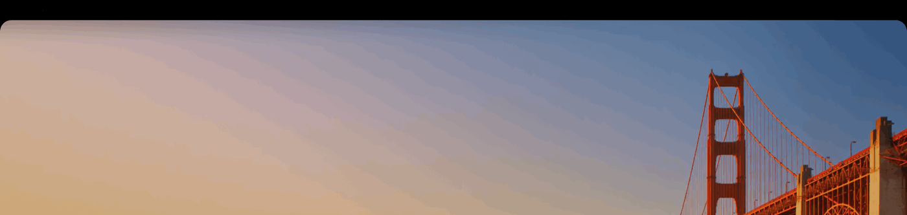

# NotchBar

<a href="README.en.md"><kbd><b>English</b></kbd></a> <a href="README.md"><kbd>简体中文</kbd></a>

Paints the macOS menu bar solid black so the notch blends into it. The wallpaper and the display resolution stay as they are.

Only shows up on MacBooks with a notch; external monitors never get the extra black strip.



> The clip covers the menu bar strip only: bar on → off → on, with the menu on the last frame.
> macOS screenshots do not include the camera housing, so what you are looking at is whether the
> strip covers the whole top edge along with the notch.

## Requirements

- macOS 13 or later
- A Mac with a notch (other Macs show nothing)

## Install

Open `NotchBar-x.y.z.dmg`, drag NotchBar into Applications, then launch it from the menu bar icon.

The app is not signed, so the first launch of a downloaded copy needs right-click → Open.

## Menu

| Item | What it does |
| --- | --- |
| Hide Notch | turns the black bar on and off |
| Corner Radius | radius of the two arcs along the bottom edge: square, 12, 18, 22 (default), 26, 32 pt |
| Launch at Login | registers a login item |
| Show Menu Bar Icon | turning it off removes the icon; use ⌃⌥N to open the menu |
| Show in Dock | off by default, the app lives only in the menu bar |
| Language | System Default / 中文 / English, applies immediately |
| About / Quit | the About panel carries the author, SingWah, and the GitHub link |

## Language

The menu ships two sets of strings and follows the system by default: Chinese if the top preferred language is `zh-*`, English otherwise.

To pin one, pick Language → 中文 / English. It takes effect immediately, no relaunch. The choice lives under the `language` key (`system` / `chinese` / `english`).

## Hiding the menu bar icon

The menu hangs off the status item, so once the icon is gone there is nothing to click. Three ways back in:

- **⌃⌥N** — opens the menu from any app, anchored under the right end of the menu bar
- **Open NotchBar again** — doing it from Applications pops the menu too
- A one-time note appears when you hide the icon, explaining both

The shortcut is unregistered as soon as the icon comes back, so it never holds a key combination while unused.

## Author

SingWah — https://github.com/SingWah

## Build from source

Command Line Tools are enough (`xcode-select --install`); no Xcode project.

```bash
scripts/build.sh        # compiles into .build/NotchBar.app (staging only)
scripts/make-dmg.sh     # produces dist/NotchBar-<version>.dmg (the only artifact)
```

`.build/` and `dist/` are both kept out of the repository.

The icon can be regenerated with `scripts/mkicon.swift`:

```bash
swift scripts/mkicon.swift Resources/icon_1024.png 1024
# then slice it at the sizes iconutil expects and pack AppIcon.icns
```

The icon is drawn in code (`mkicon.swift` holds the shape itself), not traced from an image, so the repo only keeps `icon_1024.png` and `AppIcon.icns`.

The demo GIF in `docs/` is generated locally too: capture a few states, then stitch them together.

```bash
swift scripts/make-gif.swift docs/notchbar-demo.gif 1200 \
    frame1.png:2.5 frame2.png:2.0 frame3.png:2.5 frame4.png:3.0
```

## How it works

A borderless transparent window sits just below the menu bar window (layer 23, the menu bar is 24) and draws nothing but a black strip at the top.

- The strip height comes from the real menu bar window, so it follows when the display scale changes
- Both bottom corners are drawn as outward arcs, covering the rounded corners of a maximised window so no wallpaper leaks through at the edges
- The window is 1pt wider than the screen on each side, so the outermost pixel column is fully covered
- Nothing is drawn when the screen has no notch (`safeAreaInsets.top == 0`)

The arcs default to 22pt: a standard window corner is about 20pt, and 1–2pt of margin absorbs the antialiasing. If an app draws a larger corner than that, bump the radius up one step in the menu.

## Known limitations

- **The menu bar text colour is decided by the system from the brightness at the top of the wallpaper.** With a light-topped wallpaper the text turns dark grey and is hard to read on the black strip. Switch to a darker-topped wallpaper, or turn the bar off in the menu.
- The strip stays while apps are full screen.
- The strip sits directly under the menu bar; its position follows the menu bar height and cannot be dragged.
- The shortcut for the hidden-icon case is fixed at ⌃⌥N for now. If another app owns it, turn Show Menu Bar Icon back on to release the combination.

## Uninstall

```bash
rm -rf /Applications/NotchBar.app
defaults delete io.github.notchbar
```

Then remove NotchBar from System Settings → General → Login Items & Extensions.

## Icon

`Resources/icon_1024.png` is the 1024px icon and `Resources/AppIcon.icns` is sliced from it; both come from the vector code in `scripts/mkicon.swift`.

## License

MIT
