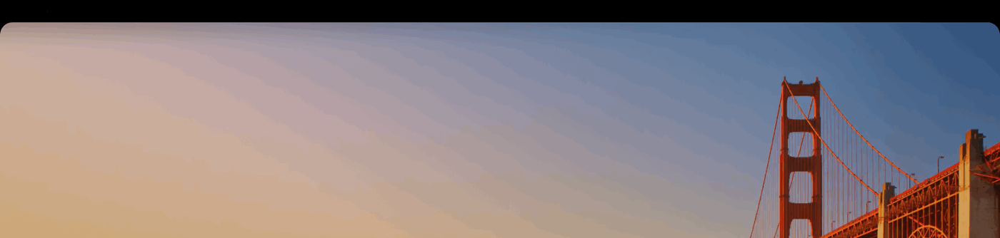

# NotchBar

<a href="README.md"><kbd><b>简体中文</b></kbd></a> <a href="README.en.md"><kbd>English</kbd></a>

把 macOS 菜单栏那一条画成纯黑，让刘海融进同色区域里。不动壁纸，不动分辨率。

只在带刘海的 MacBook 上生效；接外接显示器不会多出黑条。



> 录的是菜单栏那一条：黑条开 → 关 → 开，最后一帧是菜单。为了只看黑条本身，截图中菜单栏里的
> 应用菜单和状态图标已经抹掉；macOS 截图不含摄像头开孔，中间那个刘海是按真机尺寸（200 × 40 pt）
> 补画上去的。黑条打开时刘海与黑条同为纯黑、直接融为一体 —— 这正是这个工具要的效果。

## 要求

- macOS 13 或更高
- 带刘海的 Mac（其他机型不显示任何东西）

## 安装

打开 `NotchBar-x.y.z.dmg`，把 NotchBar 拖进「应用程序」，然后从菜单栏图标启动。

应用没有开发者签名，从网络下载的副本首次打开需要右键 → 打开。

## 菜单

| 项目 | 说明 |
| --- | --- |
| 隐藏刘海 | 开黑条 / 关黑条 |
| 圆角 | 下沿两角的圆弧半径：直角、12、18、22（默认）、26、32 pt |
| 开机启动 | 注册为登录项 |
| 在菜单栏显示图标 | 关掉之后菜单栏不再有图标，改用 ⌃⌥N 叫出菜单 |
| 在 Dock 中显示 | 默认只在菜单栏出现，不占 Dock |
| 语言 | 跟随系统 / 中文 / English，切换后立即生效 |
| 关于 / 退出 | 关于里带作者 SingWah 与 GitHub 链接 |

## 语言

菜单有中英两套文案，默认**跟随系统**：系统首选语言是 `zh-*` 就用中文，否则用英文。

要手动固定，打开「语言 → 中文 / English」即可，选择立刻生效，不用重启应用。
设置存在 `language` 键里（`system` / `chinese` / `english`）。

## 隐藏菜单栏图标

菜单挂在状态栏图标上，所以图标一关就没地方点了。为了还能改设置，关掉图标时
会自动注册全局快捷键：

- **⌃⌥N** —— 在任何应用里叫出菜单，菜单出现在菜单栏右端下方
- **重新打开 NotchBar** —— 在「应用程序」里再打开一次，也会弹出菜单
- 关掉图标时会弹一次提示，说明上面两种方式

图标重新打开后，全局快捷键会立刻注销，不占用任何键位。

## 作者

SingWah — https://github.com/SingWah

## 从源码构建

需要 Command Line Tools（`xcode-select --install`），不需要 Xcode 工程。

```bash
scripts/build.sh        # 编译到 .build/NotchBar.app（仅构建中间产物）
scripts/make-dmg.sh     # 产出 dist/NotchBar-<version>.dmg（唯一对外产物）
```

`.build/` 和 `dist/` 都不进版本库。

图标可以用 `scripts/mkicon.swift` 重新生成：

```bash
swift scripts/mkicon.swift Resources/icon_1024.png 1024
# 再按 iconutil 的尺寸要求切图，打包成 AppIcon.icns
```

图标是代码画的（`mkicon.swift` 里就是形状定义），不是从图片描出来的，所以仓库里
只留 `icon_1024.png` 和 `AppIcon.icns`，日常构建不需要重新跑。

`docs/` 里的演示动图也是本地生成：先截几张不同状态的图，过一遍 `clean-capture.swift`
（抹掉菜单栏里的应用菜单和状态图标、按真机尺寸补上刘海），再拼成 GIF。

```bash
swift scripts/clean-capture.swift raw.png clean.png --notch 400,80,16
swift scripts/make-gif.swift docs/notchbar-demo.gif 1400 \
    frame1.png:2.5 frame2.png:2.0 frame3.png:2.5 frame4.png:3.0
```

`--notch` 后面是宽、高、底部圆角，单位是截图像素 —— 2 倍屏上 400 × 80 × 16 对应 200 × 40 × 8 pt。
刘海默认不描边：黑条打开时它与黑条同为纯黑，会完全融进去；想看见轮廓就加 `--glint`。

## 工作原理

在菜单栏窗口下方（layer 23，菜单栏是 24）放一个无边框透明窗口，只绘制顶部一条黑色块。

- 黑块高度取自系统菜单栏窗口的真实高度，因此切换缩放档位时会跟着变
- 下沿两角画成向外延伸的圆弧，覆盖住最大化窗口自己的圆角，避免窗口贴顶时两侧露出壁纸
- 窗口比屏幕宽 1pt，保证屏幕最边一列像素被完整覆盖
- 屏幕顶部没有刘海（`safeAreaInsets.top == 0`）时不显示

圆弧默认 22pt：系统标准窗口的圆角约 20pt，留 1~2pt 吃掉抗锯齿。
如果某个应用自绘的圆角更大，圆弧会盖不满，可以在菜单里调大一级。

## 已知限制

- **菜单栏文字颜色由系统按壁纸顶部亮度决定**。壁纸顶部是浅色时，文字会变成深灰，
  压在黑条上不好辨认。此时换一张顶部偏暗的壁纸，或者在菜单里关掉黑条。
- 全屏应用时黑条仍然保留。
- 黑条固定在菜单栏正下方，位置由菜单栏高度决定，不能单独拖动。
- 隐藏菜单栏图标时用的快捷键固定为 ⌃⌥N，暂不支持自定义；如果它和别的应用撞键，
  把「在菜单栏显示图标」再打开即可释放键位。

## 卸载

```bash
rm -rf /Applications/NotchBar.app
defaults delete io.github.notchbar
```

再到「系统设置 → 通用 → 登录项与扩展」里移除 NotchBar。

## 图标

`Resources/icon_1024.png` 是 1024 版图标，`Resources/AppIcon.icns` 由它切分而来；
两者都由 `scripts/mkicon.swift` 里的矢量代码生成。

## 许可

MIT
